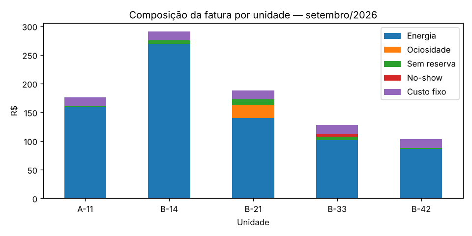

# Evidências de funcionamento

Arquivos gerados executando o próprio código do repositório, com os dados simulados de setembro/2026 (`--seed 5`).

| Arquivo | O que mostra |
|---|---|
| [`demonstracao.ipynb`](demonstracao.ipynb) | Notebook executado com o fluxo completo: geração dos dados, leitura das sessões, rateio, composição da fatura de um morador, análise de IA, cenário com anomalias e testes automatizados. As saídas ficam gravadas no notebook e podem ser vistas direto no GitHub. |
| [`sessao_terminal.txt`](sessao_terminal.txt) | Sessão real da aplicação de terminal (`main.py`): cadastro, login, reserva, recusa de reserva no mesmo horário, fatura do morador, liberação avulsa do carregador e painel do gestor (resumo, liberações, agenda, exportação e análise de IA). |
| [`composicao_fatura.png`](composicao_fatura.png) | Gráfico da composição da fatura por unidade, gerado pelo notebook. |
| [`dados/uso/`](dados/uso) | CSVs de uso do carregador usados como entrada. |
| [`dados/saida/`](dados/saida) | Saídas do rateio (`fatura_mensal.csv`, `detalhe_sessoes.csv`, `avisos.txt`) e da IA (`relatorio_ia.csv`). |
| [`dados/uso_anomalias/`](dados/uso_anomalias) e [`dados/saida_anomalias/`](dados/saida_anomalias) | Mesmo fluxo com problemas injetados nos dados (`--anomalias`): sessão sem usuário, reserva criada com pouca antecedência e consumo fora de sessão. |



## Resultados principais

- 5 moradores, 34 sessões e 774,03 kWh no mês; total a arrecadar de R$ 884,20.
- Fatura da unidade B-21 (Juliana Castro): R$ 187,60 (energia R$ 140,10 + ociosidade R$ 22,00 + sem reserva R$ 10,50 + custo fixo R$ 15,00). O notebook confere que a soma das sessões mais o custo fixo bate com o total da fatura.
- No cenário com anomalias, o rateio não atribui a sessão sem usuário a nenhum morador (fica como `NAO_IDENTIFICADO`) e emite 4 avisos; a IA também sinaliza essas sessões.
- 42 testes automatizados passando.

## Como gerar novamente

Na raiz do repositório:

```bash
python -m pip install -r requirements.txt matplotlib pexpect
python evidencias/gerar_sessao_terminal.py      # Linux/macOS (pexpect não funciona no Windows)
```

Para o notebook, abra `evidencias/demonstracao.ipynb` no Jupyter ou no VS Code e execute todas as células. Ele usa a pasta `evidencias/` como diretório de trabalho, que é o padrão dessas ferramentas.
